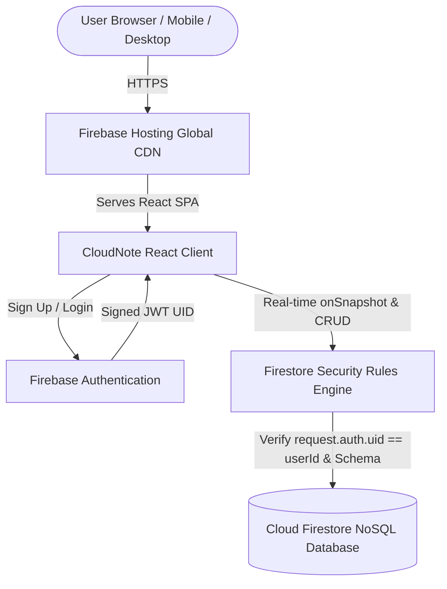

# CloudNote — Cloud-Based Notes Management System

CloudNote is a cloud-native note management web application built with **React**, **Vite**, **Tailwind CSS**, **Firebase Authentication**, **Cloud Firestore**, and **Firebase Hosting**. It demonstrates practical cloud computing principles including serverless backend-as-a-service (BaaS), multi-tenant data isolation, real-time cloud synchronization, and managed cloud identity.

---

## Features

- **Cloud Authentication**: Email/Password registration and login, plus Google Sign-In via Firebase Authentication.
- **Protected Workspace**: Dashboard and note endpoints are accessible only to authenticated users.
- **Real-Time Cloud Firestore CRUD**:
  - Create notes with a title and body content.
  - Edit notes with debounced automatic saving to Cloud Firestore and manual save (`Ctrl/Cmd + S`).
  - Pin/unpin important notes so they stay at the top of the dashboard.
  - Delete notes with an accessible confirmation dialog.
- **Instant Search & Sorting**: Filter notes live by title or content, view all or pinned notes, and sort automatically by pin priority and most recent server `updatedAt` timestamp.
- **Cross-Device Synchronization**: Log in from any browser or device to retrieve and synchronize notes in real time via `onSnapshot`.
- **Zero-Trust Security Rules**: Strict Firestore rules enforce per-user ownership, schema validation, payload size bounds, and server-side timestamps (`request.time`).

---

## Technology Stack

| Layer | Technology |
| --- | --- |
| Frontend Framework | React 19 + TypeScript |
| Build Tool | Vite |
| Styling | Tailwind CSS v4 |
| Icons | Lucide React |
| Authentication | Firebase Authentication |
| Cloud Database | Firebase Cloud Firestore |
| Cloud Hosting | Firebase Hosting |

---

## Project Structure

```text
├── firebase-applet-config.json   # Provisioned Firebase client configuration
├── firebase-blueprint.json       # Firestore entity & path blueprint
├── firebase.json                 # Firebase Hosting & Firestore config
├── .firebaserc                   # Default Firebase project alias
├── firestore.rules               # Production Firestore security rules
├── security_spec.md              # Security invariants & adversarial test matrix
├── .env.example                  # Environment variable template
├── index.html                    # HTML entry point & Google Fonts
└── src/
    ├── firebase/
    │   ├── config.ts             # Firebase App, Auth, and Firestore initialization
    │   └── errors.ts             # Structured Firestore & Auth error handlers
    ├── services/
    │   └── notesService.ts       # Firestore CRUD & real-time listener service
    ├── context/
    │   ├── AuthContext.tsx       # Authentication state & actions
    │   └── ToastContext.tsx      # Success, error, and info notifications
    ├── components/
    │   ├── AuthPages.tsx         # Login & Registration views
    │   ├── BrandLogo.tsx         # CloudNote SVG wordmark
    │   ├── ConfirmModal.tsx      # Delete confirmation modal
    │   ├── Dashboard.tsx         # Protected workspace & note grid
    │   ├── NoteCard.tsx          # Note preview card with pin/edit/delete
    │   ├── NoteEditor.tsx        # Create/Edit note view with autosave
    │   └── Sidebar.tsx           # Navigation, counts, and user profile/logout
    ├── types/note.ts             # TypeScript domain interfaces
    ├── utils/formatters.ts       # Timestamp & word-count helpers
    ├── App.tsx                   # Protected route shell
    ├── index.css                 # Tailwind CSS imports & font tokens
    └── main.tsx                  # React DOM mount
```

---

## Cloud Database Structure (Firestore)

```text
users/
  {userId}/
    uid: string
    displayName: string
    email: string
    createdAt: timestamp (serverTimestamp)
    updatedAt: timestamp (serverTimestamp)
    notes/
      {noteId}/
        title: string (max 200 chars)
        content: string (max 50,000 chars)
        isPinned: boolean
        createdAt: timestamp (serverTimestamp)
        updatedAt: timestamp (serverTimestamp)
```

---

## Setup & Installation Instructions

### 1. Install Dependencies
```bash
npm install
```

### 2. Firebase Configuration
This project loads its Firebase configuration from `firebase-applet-config.json` (provisioned for project `superb-bonito-j5gvv`).

If you are connecting your own Firebase project, either:
- Replace `firebase-applet-config.json` with your Firebase Web App credentials, **or**
- Copy `.env.example` to `.env` and populate the `VITE_FIREBASE_*` variables:
  ```bash
  cp .env.example .env
  ```

### 3. Enable Authentication Providers in Firebase Console
1. Open the [Firebase Console](https://console.firebase.google.com/) and select your project (`superb-bonito-j5gvv`).
2. Navigate to **Build → Authentication → Sign-in method**.
3. Click **Add new provider** and enable **Email/Password** (required for email registration and sign-in).
4. Ensure **Google** is also enabled for one-click Google Sign-In.

### 4. Run Locally
```bash
npm run dev
```
Open `http://localhost:3000` in your browser.

---

## Firebase Hosting Deployment Instructions

1. **Install Firebase CLI** (if not already installed):
   ```bash
   npm install -g firebase-tools
   ```
2. **Authenticate with Google**:
   ```bash
   firebase login
   ```
3. **Build the Production Bundle**:
   ```bash
   npm run build
   ```
   This outputs optimized static assets into the `dist/` directory.
4. **Deploy Hosting and Firestore Security Rules**:
   ```bash
   firebase deploy --only hosting,firestore:rules
   ```
   *(If your Firestore uses a named database ID, verify `firebase.json` or deploy rules via the Firebase Console / CLI targeting that database.)*

---

## System Architecture Diagram

```text
+-------------------------------------------------------------------+
|                        CLIENT TIER (Browser)                      |
|  React 19 + Vite + Tailwind CSS                                   |
|  +------------------+   +------------------+   +---------------+  |
|  | AuthPages        |   | Dashboard        |   | NoteEditor    |  |
|  | (Login/Register) |   | (Search/Filter)  |   | (Autosave)    |  |
|  +--------+---------+   +--------+---------+   +-------+-------+  |
|           |                      |                     |          |
|           +----------------------+---------------------+          |
|                                  |                                |
|                      Firebase Web SDK v11+                        |
|               (Auth Token + Real-Time WebSockets)                 |
+----------------------------------+--------------------------------+
                                   | HTTPS / TLS
                                   v
+-------------------------------------------------------------------+
|                     GOOGLE CLOUD / FIREBASE BaaS                  |
|                                                                   |
|  +-----------------------------+   +---------------------------+  |
|  | Firebase Authentication     |   | Firebase Hosting (CDN)    |  |
|  | - Email/Password & Google   |   | - Serves /dist SPA assets |  |
|  | - Issues signed JWT tokens  |   | - Edge caching & SSL      |  |
|  +--------------+--------------+   +---------------------------+  |
|                 |                                                 |
|                 | Verifies request.auth.uid                       |
|                 v                                                 |
|  +-------------------------------------------------------------+  |
|  | Cloud Firestore + Security Rules Engine                     |  |
|  | - Evaluates firestore.rules on every read/write             |  |
|  | - Enforces request.auth.uid == userId                       |  |
|  | - Validates schema, lengths, & server request.time          |  |
|  | - Stores /users/{userId}/notes/{noteId}                     |  |
|  +-------------------------------------------------------------+  |
+-------------------------------------------------------------------+
```



---

## How CloudNote Demonstrates Cloud Computing Concepts

1. **Software as a Service (SaaS) & Serverless BaaS**:
   CloudNote runs entirely without self-managed virtual machines or custom database servers. Authentication, database storage, real-time sync, and static asset delivery are consumed as managed cloud services (Firebase BaaS).
2. **Cloud Identity & Access Management (IAM)**:
   Firebase Authentication issues cryptographically signed JSON Web Tokens (JWTs) upon login. Every Firestore request carries this token so the cloud backend knows the caller's verified `uid`.
3. **Multi-Tenant Data Isolation**:
   All user notes reside in tenant-scoped subcollections (`/users/{userId}/notes/{noteId}`). Declarative `firestore.rules` enforce zero-trust isolation at the database boundary, ensuring User A can never read, list, modify, or delete User B's notes—even if the client UI were bypassed.
4. **Distributed Real-Time Synchronization & High Availability**:
   Cloud Firestore replicates data across multi-region cloud infrastructure and pushes live state updates to connected clients via `onSnapshot`, enabling seamless access across laptops, tablets, and phones.
5. **Server-Authoritative Consistency**:
   `createdAt` and `updatedAt` use `serverTimestamp()` validated against `request.time` in security rules, preventing client clock skew from corrupting sort order.
6. **Edge Content Delivery (Cloud Hosting)**:
   The compiled Vite bundle is deployed to Firebase Hosting's global CDN with automatic HTTPS certificates and SPA routing rewrites.
